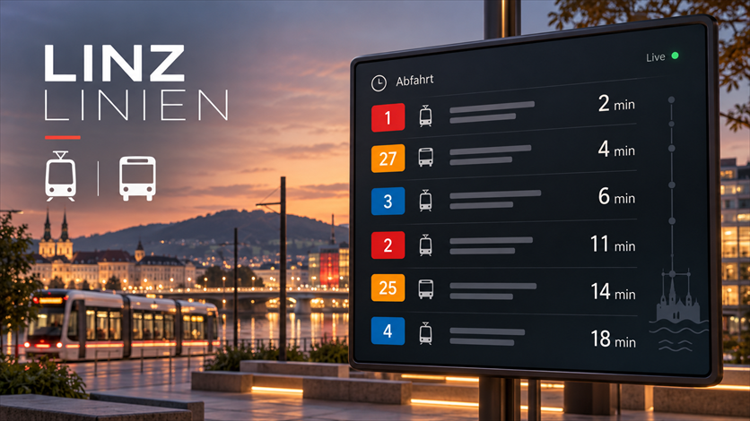

# Linz Linien Abfahrten fuer Tessera

Live-Abfahrten der LINZ AG Linien auf Tessera-Panels. Das Plugin zeigt Bus, Obus und Strassenbahn mit Ziel, Countdown und Bahnsteig.

[Changelog](CHANGELOG.md) · [Validierung](VALIDATION.md) · [Lizenz](LICENSE)

## Set up

1. In Tessera unter **Plugins** auf **Add with a link** gehen.
2. `https://github.com/Schlizor/tessera_linzlinien` einfuegen.
3. Das Plugin dem gewuenschten Bildschirm hinzufuegen und die Firmware bauen/installieren.
4. In **Layout** ein **Abfahrten**-Tile platzieren.
5. Im Feld **Haltestelle** mindestens zwei Zeichen eingeben und einen Treffer auswaehlen.
6. Layout speichern und an den Bildschirm senden.

Optional koennen ein eigener Kartentitel, ein Bahnsteig beziehungsweise eine Richtung (zum Beispiel `0` oder `1`) und bis zu sechs Linien als Filter gesetzt werden.

Die Haltestellensuche verwendet den offiziellen Linz-AG-Stopfinder. Die Auswahl speichert die interne Haltestellen-ID; diese muss normalerweise nicht manuell bekannt sein.

## Anzeige

- Die Abfahrten werden hoechstens einmal pro Minute aktualisiert.
- Bus, Obus und Strassenbahn werden gemeinsam nach der prognostizierten Abfahrtszeit sortiert.
- Jede Zeile zeigt Linie, Ziel, Countdown und - wenn vorhanden - den Bahnsteig.
- Das adaptive Tile zeigt auf 1x1 die naechste Abfahrt gross und wird auf breiteren Karten automatisch zur Liste.
- Im Listen-Tile koennen optional eine Linie und bis zu zwei Richtungen gewaehlt werden.
- Jede Karte kann einen eigenen Titel anzeigen und optional auf einen Bahnsteig beziehungsweise eine Richtung eingeschraenkt werden.
- Es koennen bis zu sechs Linien gleichzeitig ausgewaehlt werden.
- Die exakte Abfahrtsuhrzeit kann zusaetzlich zum Countdown eingeblendet werden.
- Echtzeit-Hinweise und Verspaetungen werden klein in der Karte angezeigt; ein Tippen auf die Karte oeffnet die Abfahrtsdetails.
- Die Bahnsteiganzeige kann pro Tile deaktiviert werden.
- Bei fehlenden Live-Daten bleibt die letzte erfolgreiche Antwort erhalten, soweit Tessera sie als veraltete Antwort liefert.
- Das Tile passt sich an die verfuegbare Hoehe an; groessere Tiles zeigen mehr Abfahrten.

## Datenquelle und Datenschutz

Das Plugin nutzt die oeffentlichen JSON-Endpunkte von [LINZ AG Linien](https://www.linzag.at/). Tessera uebertraegt den Suchtext beziehungsweise die ausgewaehlte Haltestellen-ID an `www.linzag.at`; Zugangsdaten werden nicht benoetigt. Es werden keine Home-Assistant-Entitaeten gelesen und keine Home-Assistant-Aktionen aufgerufen.

Details zur Datenverarbeitung stehen unter [Privacy](#privacy).

### Privacy

Die Tessera-App in Home Assistant sendet Suchtexte und die ausgewaehlte Haltestellen-ID per HTTPS an `www.linzag.at`. Die Linz AG kann dabei die Anfrage, die IP-Adresse und uebliche Verbindungsdaten sehen. Das Plugin speichert keine personenbezogenen Daten und benoetigt keinen API-Key.

## Entwicklung und Validierung

Die lokale Grundpruefung laeuft mit Python 3, PyYAML und dem Tessera-Plugin-Checker. Die Live-Endpunkte koennen mit einer Haltestelle wie `60501720` (Hauptbahnhof) getestet werden. Siehe [VALIDATION.md](VALIDATION.md) fuer die vollstaendige Checkliste.
